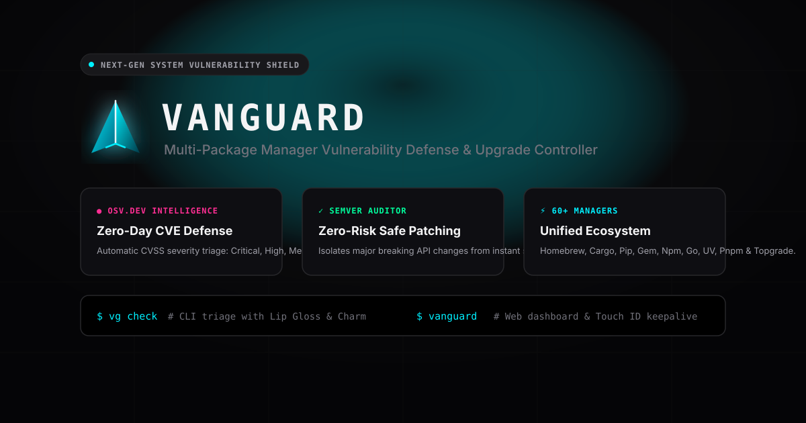

# Vanguard (`vg` / `up`)

<p align="center">
  
</p>

<p align="center">
  <a href="https://github.com/jankrloz/vanguard/releases"></a>
  <a href="https://github.com/jankrloz/vanguard/blob/main/LICENSE"></a>
  
  
</p>

> **Vanguard is a unified vulnerability shield and package update orchestrator for macOS and Linux.**  
> Scans 35+ system, language, and application package managers, correlates outdated dependencies against authoritative vulnerability databases and native security scanners, classifies updates by severity (`CRITICAL`, `HIGH`, `MEDIUM`, `LOW`) and SemVer risk (`Safe Minor/Patch` vs. `Major Breaking`), and executes upgrades through an interactive Web Dashboard or headless CLI.

---

## Key Capabilities

- **Authoritative Multi-Engine Vulnerability Detection**
  - Queries **OSV.dev** and **GitHub Security Advisories (GHSA)** in real time for every outdated package.
  - Synthesizes CycloneDX SBOM scans through **Google `osv-scanner`** and **Aqua `trivy`**.
  - Executes native package manager security audits (**`npm audit`**, **`pip-audit`**) and deduplicates CVE/GHSA identifiers across sources.
  - Displays inline vulnerability summaries, upstream advisory links, and exact remediation targets (`Fixed >= X.Y.Z` or `Zero-Day`).

- **Severity & SemVer Risk Triage**
  - **Vulnerability Advisories (`CRITICAL` / `HIGH` / `MEDIUM` / `LOW`):** Ranked first by CVSS v3.1 score and vector severity so urgent security patches are never buried under routine updates.
  - **Safe Updates (`Minor` & `Patch`):** Non-breaking SemVer updates pre-selected for one-click or automated batch execution.
  - **Major Breaking Updates (`Major`):** Isolated and unselected by default to prevent accidental breaking upgrades across toolchains.
  - **Package Pinning:** Pin or unpin specific packages to hold versions back while continuing to upgrade the rest of your environment.

- **Interactive Web Dashboard & Headless CLI**
  - **Web Dashboard (`vg`):** Filter by `All Updates`, `Vulnerabilities`, `Safe (Minor/Patch)`, `Major Breaking`, `Pinned`, or `Queued`, inspect CVE details and package descriptions, stream live upgrade stdout/stderr logs, and trigger system-wide maintenance sweeps.
  - **Headless CLI (`vg check`, `vg apply`, `vg sweep`, `vg history`, `vg monitor`):** Built for terminal workflows, CI/CD security gates (exits non-zero when vulnerabilities are detected), and scheduled background monitoring.

- **35+ Supported Package Ecosystems**
  - Unifies **Homebrew** (`brew` & `cask`), **Node.js** (`npm`, `pnpm`, `yarn`, `bun`), **Python** (`pip`, `pipx`, `uv`, `uvx`, `poetry`), **Rust** (`cargo`, `rustup`), **Go**, **RubyGems** (`gem`), **Google Cloud SDK** (`gcloud`), **PHP** (`composer`), **Mac App Store** (`mas`), **APT / APK / DNF**, and full-system **Topgrade** sweeps.

---

## Vulnerability Severity & Update Classification

```
┌──────────────────────┬───────────────────────┬──────────────────────────────────────────────────────────┐
│ Classification       │ Criteria              │ Triage & Default Behavior                                │
├──────────────────────┼───────────────────────┼──────────────────────────────────────────────────────────┤
│ CRITICAL             │ CVSS 9.0 – 10.0       │ Ranked #1 · Auto-queued · Blocks `vg check` (exit 1)     │
│ HIGH                 │ CVSS 7.0 – 8.9        │ Ranked #2 · Auto-queued · Blocks `vg check` (exit 1)     │
│ MEDIUM               │ CVSS 4.0 – 6.9        │ Ranked #3 · Auto-queued · Inline advisory summary        │
│ LOW                  │ CVSS 0.1 – 3.9        │ Ranked #4 · Inline advisory summary & remediation version│
├──────────────────────┼───────────────────────┼──────────────────────────────────────────────────────────┤
│ SAFE (MINOR / PATCH) │ SemVer < next major   │ Pre-selected for safe batch execution                    │
│ MAJOR BREAKING       │ SemVer major bump     │ Unselected by default to guard against breaking changes  │
│ PINNED               │ User-locked package   │ Excluded from upgrades until explicitly unpinned         │
└──────────────────────┴───────────────────────┴──────────────────────────────────────────────────────────┘
```

---

## Installation

### Homebrew (macOS & Linux)

```bash
brew install jankrloz/tap/vanguard
```

Installing via Homebrew automatically provisions `vanguard` (`vg` and `up` aliases) alongside its companion security and package orchestration tools (`meta-package-manager`, `topgrade`, `osv-scanner`, and `trivy`).

### Build from Source

```bash
git clone https://github.com/jankrloz/vanguard.git
cd vanguard
task build
task install
```

---

## Usage & CLI Reference

### Launch the Web Dashboard

```bash
# Start the local server and open the Web Dashboard in your browser
vg

# Run the server in headless background mode without opening a browser window
vg -no-web -port 9099
```

### Headless Vulnerability & Update Audit (`vg check`)

```bash
# Scan all active package managers and print categorized vulnerability & update report
vg check

# Show only packages with active security vulnerabilities (exits 1 if found)
vg check --security-only

# Filter by a specific package manager (e.g. brew, cask, npm, pnpm, pip, uv, gem)
vg check --manager brew

# Limit displayed rows per section
vg check --limit 20
```

### Non-Interactive Terminal Upgrades (`vg apply`)

```bash
# Upgrade all safe (minor/patch) and security-fix packages interactively
vg apply

# Auto-confirm and apply only security vulnerability fixes
vg apply --security-only --yes

# Upgrade packages for a single package manager
vg apply --manager pnpm -y

# Upgrade all outdated packages, including major version releases
vg apply --all -y
```

### System Sweep, Audit History & Continuous Monitoring

```bash
# Run a full-system Topgrade maintenance sweep (git repos, toolchains, firmware, caches)
vg sweep

# Inspect the persistent upgrade audit trail
vg history --limit 30

# Run a background vulnerability monitor with desktop notifications
vg monitor --interval 1h
```

### Dashboard Flags

| Flag | Default | Description |
|---|---|---|
| `-port <int>` | `9099` | Local HTTP server port (falls back to an available port if busy) |
| `-no-web` | `false` | Run the local server in headless mode without launching a browser |
| `-no-sudo` | `false` | Skip privilege pre-flight checks on startup |

---

## Configuration & Audit Trail

- **Configuration (`~/.config/vanguard/config.json`):** Stores pinned package identifiers and ignored package managers.
- **Audit Log (`~/.local/state/vanguard/history.jsonl`):** Records every package upgrade and system sweep with timestamp, package manager, version transition (`from` → `to`), and execution status.

---

## License

MIT © Juan Carlos Navarrete Gordillo
